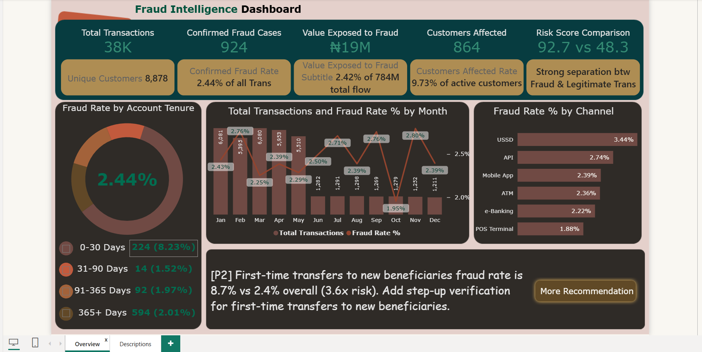
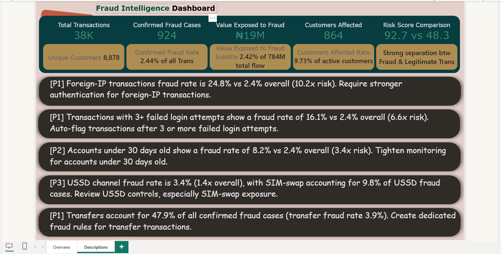

# 🛡️ Financial Fraud Intelligence & Behavioral Risk Dashboard
### Enterprise Fraud Surveillance, Behavioral Anomaly Detection & AI-Augmented BI Modeling
**Stack:** Microsoft Power BI · Power Query (M) · DAX · Claude AI FastMCP Server · Relational Modeling

[](https://powerbi.microsoft.com/)
[](https://learn.microsoft.com/en-us/dax/)
[](https://github.com/jlowin/fastmcp)
[]()

---

## 📌 Executive Summary
In digital banking and electronic payment ecosystems, undetected fraud leads not only to direct monetary write-offs but also to customer trust attrition and regulatory scrutiny. Effective fraud management requires shifting from retroactive investigations to **real-time behavioral risk intelligence and prioritized rule governance**.

This project delivers an enterprise-grade **Fraud Intelligence & Behavioral Risk Surveillance Dashboard** built in **Microsoft Power BI**, augmented via **Claude AI + Power BI FastMCP Server** for programmatic data model inspection and validation. Analyzing **37,901 validated transactional records totaling ₦784M in transaction volume across 8,878 accounts**, this surveillance platform identified **924 confirmed fraud cases exposing ₦19M in direct monetary risk**, isolated **10.2× risk uplifts in foreign IP transactions**, and established a prioritized **P1 / P2 / P3 control framework**.

---

## 🖥️ Executive Power BI Dashboard Previews

### 1️⃣ Page 1 — Overview: Executive Fraud Monitoring & Behavioral Segmentation
Features real-time headline KPIs, account tenure donut distribution, monthly fraud trajectory, and channel risk rankings.


### 2️⃣ Page 2 — Descriptions: Prioritized P1 / P2 / P3 Fraud Control Recommendations
Management decision-support layer translating elevated behavioral signals into operational security rules.


---

## 📊 Core Surveillance & Fraud KPI Snapshot

| Metric Category | Key Performance Indicator (KPI) | Analytical Value | Strategic / Operational Meaning |
| :--- | :--- | :--- | :--- |
| **Transaction Scale** | **Total Transactions** | **37,901 records (~38K)** | Verified clean transaction volume |
| **Unique Scale** | **Unique Customer Accounts** | **8,878 customers** | Customer base under active surveillance |
| **Confirmed Attacks** | **Confirmed Fraud Cases** | **924 transactions** | Validated malicious or unauthorized actions |
| **Prevalence Rate** | **Confirmed Fraud Rate** | **2.44% of transactions**| Baseline institutional fraud frequency |
| **Total Flow** | **Total Transaction Volume** | **₦784,000,000 (₦784M)** | Gross transaction liquidity monitored |
| **Direct Capital Risk**| **Value Exposed to Fraud** | **₦19,000,000 (~₦19M)** | Actual monetary volume compromised |
| **Capital Risk Rate** | **Value Exposed Rate** | **2.42% of volume** | Share of gross capital subjected to fraud |
| **Victim Impact** | **Customers Affected** | **864 unique accounts** | Unique account holders impacted by attacks |
| **Customer Risk Rate**| **Customers Affected Rate** | **9.73% of active base** | ~1 in 10 customers encountered fraud attempts |
| **Model Separation** | **Average Risk Score (Fraud vs. Legitimate)** | **92.7 vs. 48.3** | **Strong Separation (+44.4 pt gap)** between cohorts |

---

## 🚨 Critical Behavioral Risk Signals & Observed Uplift

| Risk Signal Attribute | Observed Fraud Rate | Baseline Rate | Risk Uplift | Operational Fraud Mechanism |
| :--- | :--- | :--- | :--- | :--- |
| 🌐 **Foreign IP Activity** | **24.8%** | 2.44% | **10.2× Uplift** | Cross-border VPN / Proxy credential stuffing |
| 🔑 **3+ Failed Login Attempts** | **16.1%** | 2.44% | **6.6× Uplift** | Automated brute-force authentication attacks |
| 👤 **First-Time Beneficiary Transfers** | **8.7%** | 2.44% | **3.6× Uplift** | Immediate liquidation to newly added mule accounts |
| ⏳ **New Accounts (< 30 Days Old)** | **8.2%** | 2.44% | **3.4× Uplift** | Synthetic identities & fast-exit mule onboarding |
| 📱 **USSD Payment Channel** | **3.44%** | 2.44% | **1.4× Uplift** | Unencrypted mobile channel & SIM-swap vulnerability |
| 💸 **Direct Transfer Transactions** | **3.9% (47.9% of all fraud)**| 2.44% | **Major Concentration**| Core transaction type exploited for instant cash siphon |

---

## 🏗️ Data Architecture & Star Schema Model

The data architecture combines a fact-style transactional ledger with an optimized in-memory Calendar dimension:

```text
Highbridge Fraud Dataset (37,901 Transactions)
                     │
                     ▼
[Power Query ETL & Data Profiling]
 • Removed broken corrupted row (TXN100035791)
 • Parsed timestamp into proper DateTime & extracted Transaction Date
 • Converted Boolean flags: is_fraud, is_foreign_transaction, is_new_beneficiary
 • Segmented account_tenure_days into standardized chronological buckets
                     │
                     ▼
[Relational Model in Power BI]
 Calendar (Date Dimension)  1 ───────◄ * FraudTransactions (Fact Ledger)
 [Date]                                  [Transaction Date]
                     │
                     ▼
[AI-Augmented DAX Calculation Layer via Claude FastMCP]
 • Dynamic SWITCH(TRUE()) risk labels
 • Filter-context responsive KPI measures
 • Real-time model validation and schema verification
```

---

## 💻 Core DAX Surveillance Measures

### 1. Headline Fraud Metrics
```dax
Confirmed Fraud Cases = 
CALCULATE(
    COUNTROWS(FraudTransactions),
    FraudTransactions[is_fraud] = TRUE()
)

Confirmed Fraud Rate = 
DIVIDE([Confirmed Fraud Cases], [Total Transactions])
```

### 2. Monetary Exposure Calculation
```dax
Value Exposed to Fraud = 
CALCULATE(
    SUM(FraudTransactions[transaction_amount_ngn]),
    FraudTransactions[is_fraud] = TRUE()
)
```

### 3. Dynamic Risk Score Separation
```dax
Average Fraud Risk Score = 
CALCULATE(
    AVERAGE(FraudTransactions[risk_score]),
    FraudTransactions[is_fraud] = TRUE()
)

Average Legitimate Risk Score = 
CALCULATE(
    AVERAGE(FraudTransactions[risk_score]),
    FraudTransactions[is_fraud] = FALSE()
)

Risk Separation Label = 
SWITCH(
    TRUE(),
    ABS([Average Fraud Risk Score] - [Average Legitimate Risk Score]) >= 20, "Strong separation",
    ABS([Average Fraud Risk Score] - [Average Legitimate Risk Score]) >= 10, "Moderate separation",
    "Weak separation"
)
```

---

## 🎯 Prioritized Control Actions (P1 / P2 / P3 Governance)

### 🔴 Priority 1 (Immediate Hard Controls)
1. **Mandatory Step-Up MFA for Foreign IPs:** Because foreign IP transactions exhibit a **24.8% fraud rate (10.2× overall baseline)**, mandate biometric or out-of-band hardware token verification for all non-domestic sessions.
2. **Brute-Force Rate Limiting:** Auto-suspend transactions and lock checkout sessions when an account records **3 or more failed login attempts (16.1% fraud rate / 6.6× uplift)**.
3. **Dedicated Fund Transfer Rules:** Since **transfers represent 47.9% of all confirmed fraud cases**, enforce progressive hold limits on rapid consecutive transfers.

### 🟡 Priority 2 (Medium-Term Interventions)
4. **First-Time Beneficiary Cooling Period:** Introduce a 2-hour transaction clearance window for fund transfers sent to newly registered beneficiaries (**8.7% fraud rate / 3.6× uplift**).
5. **New Account Velocity Caps (< 30 Days):** Restrict daily withdrawal thresholds on accounts younger than 30 days (**8.2% fraud rate / 3.4× uplift**) until identity seasoning is complete.

### 🟢 Priority 3 (Channel Hardening)
6. **USSD & SIM-Swap Verification:** Integrate real-time telco API checks to detect recent SIM-swap activity on USSD transactions (**3.44% fraud rate**).

---

## 📂 Repository Structure
```text
fraud-intelligence-dashboard-powerbi/
│
├── HighBridge_Fraud_Dashboard.pbix                                    # Interactive 2-Page Power BI Executive Dashboard
├── highbridge_fraud_detection_dataset_2026.csv                         # Clean transaction dataset (37,901 records, ₦784M volume)
├── Fraud_Intelligence_Dashboard_Complete_Project_Report_v3.docx       # In-depth 21-section executive documentation & DAX catalogue
│
├── dashboard_overview_page.png                                         # View 1: Executive KPI overview & channel/tenure diagnostics
├── dashboard_descriptions_page.png                                     # View 2: Prioritized P1/P2/P3 risk recommendations
│
├── requirements.txt                                                    # Python / FastMCP server dependencies
├── .gitignore                                                          # Ignores temp files, Office locks (~$*), and caches
└── README.md                                                           # Master project pitch deck & technical risk architecture
```

---

## 🚀 How to Run & Replicate

1. **Clone the Repository:**
   ```bash
   git clone https://github.com/ravinder0710/fraud-intelligence-dashboard-powerbi.git
   cd fraud-intelligence-dashboard-powerbi
   ```

2. **Open the Power BI Dashboard:**
   - Launch **Microsoft Power BI Desktop**.
   - Open `HighBridge_Fraud_Dashboard.pbix`.
   - The data model is self-contained. Refresh connection if mapping to local CSV path.

3. **Explore Interactive Features:**
   - On **Page 1 (Overview)**: Interact with tenure donuts, monthly fraud trend lines, and channel bars.
   - Click the **[More Recommendation]** button to navigate directly to **Page 2 (Descriptions)** for P1/P2/P3 rules.

---

## 👨‍💼 Author & Contact
**Ravinder Gupta**  
*Data Analyst | Business Intelligence & Fraud Risk Specialist*  
- 📍 **Location:** Alwar, Rajasthan, India  
- 📧 **Email:** [iamravindergupta17@gmail.com](mailto:iamravindergupta17@gmail.com)  
- 💬 **WhatsApp:** [+91 9982637026](https://wa.me/919982637026?text=Hi%20Ravinder,%20saw%20your%20Fraud%20Intelligence%20portfolio)
- 💼 **LinkedIn:** [linkedin.com/in/ravinder-gupta-da](https://linkedin.com/in/ravinder-gupta-da)  
- 🐙 **GitHub:** [github.com/ravinder0710](https://github.com/ravinder0710)
